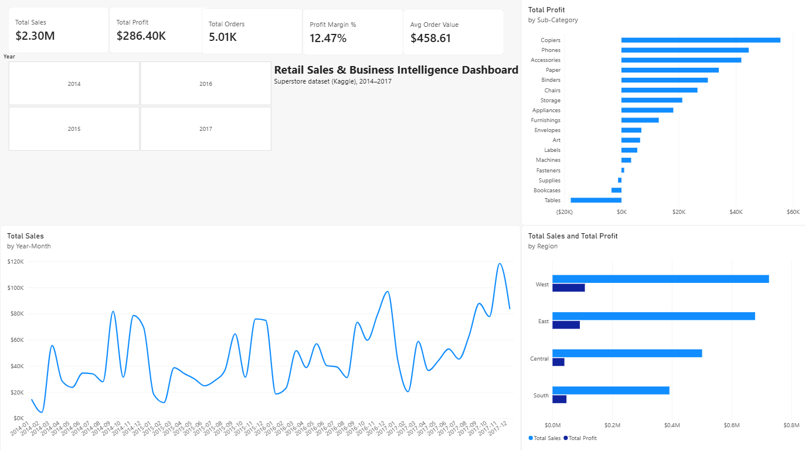

# Retail Sales & Business Intelligence Dashboard

An end-to-end analytics project on the Superstore retail dataset: data cleaning
and analysis in Python, SQL analysis in SQLite, and an interactive Power BI
dashboard. The analysis finds where the business earns and loses money.



## Questions answered
- What are total sales, profit, orders and average order value?
- Which categories, sub-categories and regions perform best and worst?
- How do sales change by month and year?
- Where is the business losing money, and what is driving it?

## Key findings
All figures come from the data (details in `reports/`).
- Total sales 2,297,200.86; profit 286,397.02 (margin 12.47%); 5,009 orders.
- Profit turns negative above a 20% discount. Rows discounted above 20% lose
  about 135,000 in total.
- Furniture has a 2.49% margin because of Tables (-17,725 profit) and
  Bookcases (-3,473). Tables earn +13,276 at 0% discount.
- West has the best margin (14.94%); Central has the worst (7.92%) and the
  heaviest discounting.
- Sales peak in September, November and December.
- Tested and rejected: November's low margin is not explained by discounting.

See `reports/business_insights.md` for insights and recommendations.

## Tech stack
Python (pandas, NumPy, Matplotlib, Seaborn), SQLite, Power BI Desktop, Git.

## Project structure
```
retail-sales-bi-dashboard/
├── notebooks/   01 cleaning, 02 EDA, 03 quality checks
├── src/         scripts to load the SQLite database and run SQL files
├── sql/         analysis queries (KPIs, category, year, discount bands, joins)
├── reports/     project brief, cleaning log, EDA findings, insights, test log
├── screenshots/ charts and dashboard screenshot
├── requirements.txt
└── README.md
```
The `data/` folder and the Power BI `.pbix` file are not included in this
repository (see Dataset).

## Dataset
Superstore Dataset by vivek468 on Kaggle:
https://www.kaggle.com/datasets/vivek468/superstore-dataset-final

9,994 rows and 21 columns of retail orders from 2014 to 2017. The data is not
redistributed here. Download it from Kaggle and check the terms listed on that
page before reuse.

## How to run
1. Install Python 3 and create a virtual environment, then
   `pip install -r requirements.txt`.
2. Download the dataset from Kaggle and save it as `data/superstore_raw.csv`.
3. Run `notebooks/01_data_cleaning.ipynb` to create `data/superstore_clean.csv`.
4. Run `notebooks/02_eda.ipynb` for the exploratory analysis.
5. Build the database: `python src/load_to_sqlite.py`, then
   `python src/build_customers_table.py`.
6. Run any query: `python src/run_sql.py sql/01_kpis.sql`.
7. Run `notebooks/03_quality_checks.ipynb` to validate the data.

## Power BI dashboard
Built from `superstore_clean.csv` with a DAX date table and these measures:
- Total Sales = SUM(superstore_clean[Sales])
- Total Profit = SUM(superstore_clean[Profit])
- Total Orders = DISTINCTCOUNT(superstore_clean[Order ID])
- Avg Order Value = DIVIDE([Total Sales], [Total Orders])
- Profit Margin % = DIVIDE([Total Profit], [Total Sales])

The dashboard has KPI cards, a year slicer, a monthly sales trend, profit by
sub-category and sales and profit by region, all cross-filtering.

## Validation
Totals were cross-checked between Python, SQL and Power BI. See
`reports/testing_log.md`.

## Limitations
- Association is not proof of cause. Product mix and shipping cost are not in
  the dataset, and there is no cost column.
- Four years of data from a sample dataset, not a real company.

## Author
Daksh Dhyani, BCA Data Science (Hons.), Chandigarh University